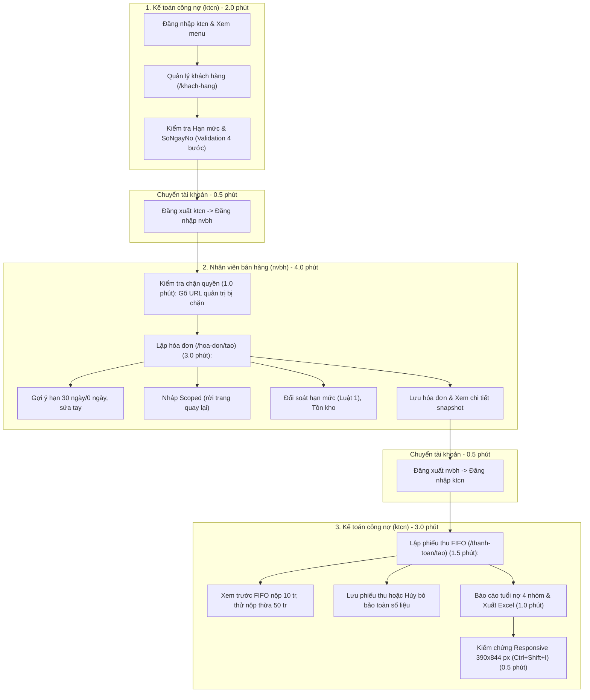

# HƯỚNG DẪN KỊCH BẢN DEMO & BỘ CÂU HỎI VẤN ĐÁP BẢO VỆ ĐỒ ÁN CAPSTONE

- **Môn học**: Lập trình Ứng dụng Web / Đồ án Capstone (ECO2415)
- **Đề tài**: Đề số 18 – Bán hàng & Công nợ Khách hàng (Sales & Accounts Receivable)
- **Nền tảng**: .NET 8 / C#
- **Mô hình Blazor**: Classic Blazor Server (`AddServerSideBlazor`, `MapBlazorHub`, `_Host.cshtml`)
- **Kiến trúc**: Clean Architecture 4 tầng (`CoreBusiness → UseCases → Plugins/DataStore → WebApp`)
- **Tài liệu đối chiếu**: [GRADING.md](file:///d:/LapTrinhUngDungWeb/DoAnCuoiKy/DuAn_BanHangVaCongNoKhachHang/GRADING.md)

---

## PHẦN I: KỊCH BẢN DEMO CHUẨN XÁC 10 PHÚT

> [!IMPORTANT]
> **Quy ước an toàn & Dữ liệu Demo:**
> - **Luồng vai trò tuần tự tối ưu**: `ktcn` (Quản lý khách hàng) $\rightarrow$ `nvbh` (Lập hóa đơn) $\rightarrow$ `ktcn` (Thu tiền FIFO & Báo cáo).
> - **Tài khoản**: `ktcn` (Kế toán công nợ) và `nvbh` (Nhân viên bán hàng). Mật khẩu được nhập trực tiếp theo cấu hình bảo mật cục bộ; tài liệu này tuyệt đối **không lưu mật khẩu**.
> - **Dữ liệu demo chuẩn**: Dựa trên dữ liệu mẫu đã nạp trong script [03_Safe_SeedSampleData.sql](file:///d:/LapTrinhUngDungWeb/DoAnCuoiKy/DuAn_BanHangVaCongNoKhachHang/BanHang.DataStore.SQL/Scripts/03_Safe_SeedSampleData.sql).
> - **Bảo toàn dữ liệu demo**: Phân biệt rõ ràng giữa thao tác **chỉ Xem trước (Preview)** và thao tác **thực sự Lưu (Write)** để tránh làm sai lệch số liệu công nợ cho các lượt demo sau.



---

### Bước 1: Kế toán công nợ — Khách hàng, Hạn mức & Số ngày nợ (Thời lượng: 2.0 phút)

- **Vai trò & Tài khoản**: `ktcn` (Kế toán công nợ)
- **Đường dẫn**: `/login` $\rightarrow$ `/khach-hang`
- **Thao tác thực hiện**:
  1. Truy cập `/login`, nhập tài khoản `ktcn` và mật khẩu, đăng nhập vào hệ thống.
  2. Quan sát thanh NavMenu: Hiển thị đầy đủ cả 5 menu (**Khách hàng**, **Sản phẩm**, **Hóa đơn**, **Thanh toán**, **Báo cáo tuổi nợ**).
  3. Chọn menu **Khách hàng** (`/khach-hang`), quan sát danh sách khách hàng mẫu:
     - `KH001` - Công ty TNHH Minh Khang: Hạn mức: `100,000,000 đ`, Thời hạn nợ: **30 ngày**.
     - `KH002` - DNTN Thiết Bị Hoàng Long: Hạn mức: `50,000,000 đ`, Thời hạn nợ: **15 ngày**.
     - `KH004` - Cửa Hàng Bán Lẻ Tân Tiến: Hạn mức: `0 đ`, Thời hạn nợ: **0 ngày** (thanh toán trong ngày).
  4. Bấm **+ Thêm khách hàng** mở modal form (Mã tự sinh `KHxxx`). Nhập tên khách hàng thử nghiệm.
  5. **Thao tác kiểm chứng Validation ô Số ngày nợ (Chỉ xem trước, không lưu)**:
     - *Thử 1 (Số âm)*: Nhập `-1` $\rightarrow$ Hiện lỗi: *"Số ngày nợ phải là số nguyên không âm..."*.
     - *Thử 2 (Số lẻ)*: Đổi thành `2.5` $\rightarrow$ Lỗi cũ biến mất, CHỈ hiện duy nhất lỗi định dạng: *"Số ngày nợ phải là số nguyên không âm hợp lệ (không chứa số lẻ hoặc chữ)."*.
     - *Thử 3 (Để trống)*: Xóa sạch ô nhập $\rightarrow$ CHỈ hiện lỗi bắt buộc: *"Số ngày nợ là bắt buộc (nhập 0 nếu thanh toán cùng ngày)."*.
     - *Thử 4 (Hợp lệ)*: Nhập `30` $\rightarrow$ Toàn bộ lỗi biến mất, ô nhập hợp lệ.
  6. Bấm nút **Hủy bỏ** để đóng form, không ghi dữ liệu rác.
- **Kết quả cần quan sát & chỉ điểm cho Hội đồng**:
  - Giao diện Blazor Mẫu A responsive.
  - Thuộc tính C# `LoiSoNgayNoHienThi` trong [KhachHangPage.razor](file:///d:/LapTrinhUngDungWeb/DoAnCuoiKy/DuAn_BanHangVaCongNoKhachHang/DuAn_BanHangVaCongNoKhachHang/Pages/KhachHangPage.razor) điều phối trực tiếp giữa `InputNumber`, `DataAnnotations` và `ValidationMessageStore` mà không ẩn thông báo bằng CSS.

---

### Chuyển tài khoản (ktcn $\rightarrow$ nvbh) (Thời lượng: 0.5 phút)
- Bấm nút **Đăng xuất** ở góc phải (`/logout`) $\rightarrow$ Quay về màn hình `/login`.
- Đăng nhập bằng tài khoản `nvbh` (Nhân viên bán hàng).

---

### Bước 2: Nhân viên bán hàng — Kiểm tra Chặn quyền (RBAC) (Thời lượng: 1.0 phút)

- **Vai trò & Tài khoản**: `nvbh` (Nhân viên bán hàng)
- **Đường dẫn**: `/hoa-don`
- **Thao tác thực hiện**:
  1. Sau khi đăng nhập `nvbh`, quan sát NavMenu: Chỉ hiển thị menu **Trang chủ** và **Hóa đơn**. Các menu kế toán (**Khách hàng**, **Sản phẩm**, **Thanh toán**, **Báo cáo tuổi nợ**) bị ẩn hoàn toàn.
  2. **Thử nghiệm gõ URL trực tiếp trên trình duyệt**:
     - Gõ `http://localhost:.../khach-hang` hoặc `.../thanh-toan` trên thanh địa chỉ rồi nhấn Enter.
     - Quan sát: Hệ thống lập tức kích hoạt `<AuthorizeRouteView>` chặn truy cập và hiển thị thông báo từ chối truy cập / yêu cầu vai trò kế toán.
  3. Bấm vào menu **Hóa đơn** (`/hoa-don`) để chuẩn bị cho bước lập hóa đơn.
- **Kết quả cần quan sát & chỉ điểm cho Hội đồng**:
  - Cơ chế phân quyền tầng giao diện qua [NavMenu.razor](file:///d:/LapTrinhUngDungWeb/DoAnCuoiKy/DuAn_BanHangVaCongNoKhachHang/DuAn_BanHangVaCongNoKhachHang/Shared/NavMenu.razor) và thẻ `@attribute [Authorize]` chặn đứng việc truy cập trái phép.

---

### Bước 3: Nhân viên bán hàng — Lập Hóa Đơn Bán Chịu & Nháp Scoped (Thời lượng: 3.0 phút)

- **Vai trò & Tài khoản**: `nvbh` (Nhân viên bán hàng)
- **Đường dẫn**: `/hoa-don` $\rightarrow$ Bấm **+ Lập hóa đơn** (`/hoa-don/tao`)
- **Thao tác thực hiện**:
  1. **Kiểm chứng gợi ý hạn nợ tự động**:
     - Chọn khách hàng `KH001` (Số ngày nợ: 30, Ngày lập: 19/10/2026) $\rightarrow$ Ô Hạn thanh toán tự động gợi ý: **18/11/2026** (tháng 10 có 31 ngày: $19 + 30 = 49 - 31 = 18$).
     - Đổi sang khách hàng `KH004` (Số ngày nợ: 0) $\rightarrow$ Hạn thanh toán tự động đổi thành **19/10/2026** (cùng ngày lập). Giải thích: Hạn trong ngày lập, không đồng nghĩa là thu tiền ngay.
  2. **Kiểm chứng sửa hạn thanh toán bằng tay**:
     - Chọn lại `KH001`, tự gõ sửa hạn thành **25/11/2026** (hệ thống bật cờ `daSuaHanThanhToanBangTay = true`).
     - Đổi Ngày lập hóa đơn sang **22/10/2026** $\rightarrow$ Hạn sửa tay `25/11/2026` được giữ nguyên, không bị hàm gợi ý tự động ghi đè.
  3. **Kiểm chứng trạng thái Nháp Scoped**:
     - Bấm **+ Thêm sản phẩm**, chọn `SP001` - Máy in hóa đơn nhiệt Epson (3,500,000 đ), số lượng: `2`.
     - Bấm quay lại trang danh sách `/hoa-don`, sau đó bấm lại vào **+ Lập hóa đơn** (`/hoa-don/tao`) trong cùng circuit.
     - Quan sát: Toàn bộ thông tin khách hàng `KH001`, ngày lập `22/10/2026`, hạn sửa tay `25/11/2026` và dòng sản phẩm `SP001` (Số lượng: 2) được khôi phục nguyên vẹn.
  4. **Kiểm chứng Luật 1: Đối soát Hạn mức tín dụng**:
     - Khối thông tin tín dụng `KH001`: Hạn mức: `100,000,000 đ`, Dư nợ hiện tại: `23,000,000 đ`, Hạn mức khả dụng còn lại: `77,000,000 đ`.
     - Thêm sản phẩm `SP004` - Màn hình cảm ứng POS (8,500,000 đ), nhập số lượng `10` cái (Thành tiền: 85,000,000 đ) $\rightarrow$ Tổng tiền mới: `92,000,000 đ` $>$ `77,000,000 đ` còn lại $\rightarrow$ Thẻ cảnh báo chuyển sang đỏ: **VƯỢT HẠN MỨC CÔNG NỢ**, nút Lưu hóa đơn bị chặn.
  5. **Kiểm chứng Chống bán vượt tồn kho**:
     - Xóa dòng `SP004`, chọn `SP005` - Két đựng tiền (Tồn kho: 30 cái), nhập số lượng `50` cái $\rightarrow$ Báo lỗi tồn kho không đủ.
  6. **Lưu hóa đơn hợp lệ**:
     - Điều chỉnh lại chỉ mua `SP001` với số lượng `2` cái (Tổng tiền: 7,000,000 đ $\le$ 77 triệu khả dụng). Trạng thái chuyển xanh hợp lệ.
     - Bấm **Lưu hóa đơn** $\rightarrow$ Hệ thống thực thi Transaction: cấp mã tự sinh `HDxxx`, ghi Header, ghi Line, trừ 2 cái tồn kho `SP001`, xóa nháp và điều hướng về danh sách.
     - Bấm xem chi tiết hóa đơn vừa lập: Đơn giá snapshot `3,500,000 đ` được lưu vĩnh viễn trong chi tiết hóa đơn.
- **Kết quả cần quan sát & chỉ điểm cho Hội đồng**:
  - Luật hạn mức [KhachHang.cs](file:///d:/LapTrinhUngDungWeb/DoAnCuoiKy/DuAn_BanHangVaCongNoKhachHang/BanHang.CoreBusiness/KhachHang.cs) được gọi trong Transaction có khóa `WITH (UPDLOCK, HOLDLOCK)` của [HoaDonRepository.cs](file:///d:/LapTrinhUngDungWeb/DoAnCuoiKy/DuAn_BanHangVaCongNoKhachHang/BanHang.DataStore.SQL/HoaDonRepository.cs).
  - Dịch vụ Scoped [HoaDonNhapStateService.cs](file:///d:/LapTrinhUngDungWeb/DoAnCuoiKy/DuAn_BanHangVaCongNoKhachHang/BanHang.UseCases/HoaDonScreen/HoaDonNhapStateService.cs) lưu giữ nháp trong bộ nhớ circuit.

---

### Chuyển tài khoản (nvbh $\rightarrow$ ktcn) (Thời lượng: 0.5 phút)
- Bấm **Đăng xuất** tài khoản `nvbh` $\rightarrow$ Đăng nhập lại bằng tài khoản `ktcn`.

---

### Bước 4: Kế toán công nợ — Thu tiền Khách hàng & Phân bổ FIFO (Thời lượng: 1.5 phút)

- **Vai trò & Tài khoản**: `ktcn` (Kế toán công nợ)
- **Đường dẫn**: `/thanh-toan` $\rightarrow$ Bấm **+ Lập phiếu thu** (`/thanh-toan/tao`)
- **Đối chiếu số liệu nợ của `KH001` từ DB seed**:
  - `HD002` (01/08/2026): Nợ gốc 6.8 tr, đã trả 2.3 tr $\rightarrow$ Còn nợ: **4,500,000 đ**.
  - `HD004` (25/08/2026): Nợ gốc 9.7 tr, đã trả 0 tr $\rightarrow$ Còn nợ: **9,700,000 đ**.
  - `HD003` (05/10/2026): Nợ gốc 8.8 tr, đã trả 0 tr $\rightarrow$ Còn nợ: **8,800,000 đ**.
  *(Nếu ở Bước 3 đã bấm Lưu hóa đơn mới 7.0 tr, sẽ có thêm 1 hóa đơn mới ở cuối danh sách).*
- **Thao tác thực hiện (Phân định rõ Xem trước vs Lưu thật)**:
  1. Chọn khách hàng `KH001`: Bảng bên trái hiển thị danh sách hóa đơn còn nợ theo thứ tự ngày tăng dần (FIFO).
  2. **Thao tác CHỈ XEM TRƯỚC 1 (Thu 10 triệu đồng)**:
     - Nhập số tiền thu: `10,000,000 đ`, phương thức: `Chuyển khoản`.
     - Quan sát khối xem trước FIFO (Cột phải):
       - `HD002` (cũ nhất): Cấn trừ đủ `4,500,000 đ` $\rightarrow$ Còn nợ: `0 đ` (Hoàn tất).
       - `HD004` (kế tiếp): Cấn trừ `5,500,000 đ` $\rightarrow$ Còn nợ: `4,200,000 đ` (Một phần).
       - `HD003`: Cấn trừ `0 đ` $\rightarrow$ Còn nợ: `8,800,000 đ`.
       - Đã phân bổ: `10,000,000 đ`, Chưa phân bổ: `0 đ`.
  3. **Thao tác CHỈ XEM TRƯỚC 2 (Khách nộp thừa tiền 50 triệu)**:
     - Đổi số tiền thành `50,000,000 đ`.
     - Toàn bộ hóa đơn được cấn trừ về 0 đ.
     - Số tiền dư còn lại hiển thị rõ tại ô **Chưa phân bổ (dư)** màu vàng cảnh báo.
  4. **Quyết định Lưu thật hay Hủy bỏ**:
     - *Khuyến nghị khi thi*: Bấm **Hủy bỏ** sau khi đã trình diễn xong kết quả xem trước FIFO để bảo toàn dữ liệu cho lượt demo tiếp theo không bị lệch số nợ.
     - *Nếu Hội đồng yêu cầu lưu thật*: Đổi lại số tiền `10,000,000 đ` rồi bấm **Lưu phiếu thu** $\rightarrow$ Hệ thống thực thi transaction cấp mã `PTxxx` và ghi nhận phân bổ.
- **Kết quả cần quan sát & chỉ điểm cho Hội đồng**:
  - Thuật toán FIFO độc lập tại [ThuatToanFIFO.cs](file:///d:/LapTrinhUngDungWeb/DoAnCuoiKy/DuAn_BanHangVaCongNoKhachHang/BanHang.CoreBusiness/ThuatToanFIFO.cs) phương thức `PhanBoTienThanhToan`.
  - Khóa `sp_getapplock` trong transaction tại [ThanhToanRepository.cs](file:///d:/LapTrinhUngDungWeb/DoAnCuoiKy/DuAn_BanHangVaCongNoKhachHang/BanHang.DataStore.SQL/ThanhToanRepository.cs) phương thức `TaoThanhToanAsync`.

---

### Bước 5: Kế toán công nợ — Báo cáo Tuổi nợ & Xuất Excel (Thời lượng: 1.0 phút)

- **Vai trò & Tài khoản**: `ktcn` (Kế toán công nợ)
- **Đường dẫn**: `/bao-cao-tuoi-no`
- **Thao tác thực hiện**:
  1. Chọn Ngày chốt báo cáo: `19/10/2026`, bấm **Xem báo cáo**.
  2. Quan sát bảng tổng hợp tuổi nợ phân loại theo 4 nhóm hạn nợ:
     - **0–30 ngày**: Khoản nợ chưa đến hạn hoặc quá hạn $\le$ 30 ngày.
     - **31–60 ngày**: Khoản nợ quá hạn từ 1 đến 2 tháng.
     - **61–90 ngày**: Khoản nợ quá hạn từ 2 đến 3 tháng.
     - **Trên 90 ngày**: Nợ xấu quá hạn trên 3 tháng (ví dụ hóa đơn `HD007` của `KH003` nợ từ tháng 5/2026).
  3. Đối chiếu phương trình cân đối: Cột `Tổng công nợ` luôn bằng tổng 4 cột tuổi nợ.
  4. Bấm nút **Xuất Excel** $\rightarrow$ File `.xlsx` được tải về máy. Mở tệp Excel minh chứng: Tiêu đề báo cáo, định dạng tiền tệ `#,##0 đ`, giá trị tổng cộng được ghi nhận chính xác, không dùng công thức ngoài để chống formula injection.
- **Kết quả cần quan sát & chỉ điểm cho Hội đồng**:
  - Phân tích tuổi nợ tại [PhanTichTuoiNoService.cs](file:///d:/LapTrinhUngDungWeb/DoAnCuoiKy/DuAn_BanHangVaCongNoKhachHang/BanHang.CoreBusiness/PhanTichTuoiNoService.cs).
  - Xuất Excel ClosedXML tại [ClosedXmlBaoCaoTuoiNoExcelExporter.cs](file:///d:/LapTrinhUngDungWeb/DoAnCuoiKy/DuAn_BanHangVaCongNoKhachHang/BanHang.Reports.Excel/ClosedXmlBaoCaoTuoiNoExcelExporter.cs) phương thức `ExportAsync`.

---

### Bước 6: Kiểm chứng Giao diện Responsive Viewport 390 × 844 (Thời lượng: 0.5 phút)

- **Mục tiêu**: Chứng minh giao diện tương thích tốt trên màn hình điện thoại di động (Tiêu chí K3.4).
- **Thao tác thực hiện**:
  1. Nhấn tổ hợp phím **`Ctrl + Shift + I`** (hoặc `F12`) mở công cụ DevTools trên trình duyệt.
  2. Bật chế độ giả lập thiết bị (Toggle device toolbar), chọn hoặc nhập đúng kích thước **Responsive viewport 390 × 844 px** (chuẩn iPhone 12/13/14 Pro).
  3. Quan sát các đặc điểm responsive thực tế của hệ thống:
     - **Thanh điều hướng**: Tự động thu gọn thành menu Hamburger, bấm mở ra mượt mà.
     - **Bảng dữ liệu**: Bảng danh sách hóa đơn `/hoa-don` và bảng tuổi nợ `/bao-cao-tuoi-no` được bọc trong container `table-responsive`, cho phép cuộn ngang mượt mà, không làm vỡ bố cục tổng thể của trang web.
     - **Form nhập liệu**: Ô nhập liệu và nút bấm co giãn 100% bề rộng, dễ thao tác ngón tay.
- **Kết quả cần quan sát & chỉ điểm cho Hội đồng**:
  - Các quy tắc CSS responsive trong [app.css](file:///d:/LapTrinhUngDungWeb/DoAnCuoiKy/DuAn_BanHangVaCongNoKhachHang/DuAn_BanHangVaCongNoKhachHang/wwwroot/css/app.css).

---

## PHẦN II: BỘ 15 CÂU HỎI VẤN ĐÁP TRỌNG TÂM KÈM MINH CHỨNG CODE

> [!TIP]
> Khi trả lời Hội đồng:
> 1. Trả lời thẳng vào bản chất bằng 2–3 câu ngắn gọn.
> 2. Mở trực tiếp file và tên phương thức minh chứng bên dưới để chỉ cho thầy cô thấy code thật, không trả lời lý thuyết suông.

---

### Câu 1: Dự án tuân thủ chiều phụ thuộc Clean Architecture như thế nào?
- **Trả lời**: Hệ thống chia làm 4 project với nguyên tắc phụ thuộc một chiều hướng tâm:
  - `BanHang.CoreBusiness` nằm ở lõi, độc lập hoàn toàn, không tham chiếu bất kỳ project hay thư viện ngoài nào.
  - `BanHang.UseCases` chỉ tham chiếu duy nhất `CoreBusiness`, chứa các interface và logic điều phối.
  - `BanHang.DataStore.SQL` (Plugin) tham chiếu `UseCases` và `CoreBusiness`, cài đặt chi tiết truy xuất SQL.
  - `DuAn_BanHangVaCongNoKhachHang` (Presentation) chỉ inject các UseCase interface tại các trang Razor và kết nối các tầng tại Composition Root (`Program.cs`).
- **File & Phương thức minh chứng**:
  - [BanHang.CoreBusiness.csproj](file:///d:/LapTrinhUngDungWeb/DoAnCuoiKy/DuAn_BanHangVaCongNoKhachHang/BanHang.CoreBusiness/BanHang.CoreBusiness.csproj): Không có bất kỳ thẻ `<ProjectReference>` hay `<PackageReference>` nào.
  - [BanHang.UseCases.csproj](file:///d:/LapTrinhUngDungWeb/DoAnCuoiKy/DuAn_BanHangVaCongNoKhachHang/BanHang.UseCases/BanHang.UseCases.csproj): Chỉ có 1 thẻ tham chiếu `CoreBusiness`.

---

### Câu 2: Tại sao Interface Repository đặt ở UseCases mà không đặt ở DataStore.SQL?
- **Trả lời**: Đây là việc áp dụng nguyên lý **Dependency Inversion Principle (DIP)** của SOLID. Tầng nghiệp vụ cấp cao (`UseCases`) không được phụ thuộc vào chi tiết công nghệ cấp thấp (`DataStore.SQL`). Ngược lại, tầng UseCases sở hữu interface để quy định "tôi cần dữ liệu gì", còn DataStore.SQL đóng vai trò plugin phụ thuộc ngược vào UseCases để cài đặt cụ thể bằng Dapper/SQL Server.
- **File & Phương thức minh chứng**:
  - Interface: [IKhachHangRepository.cs](file:///d:/LapTrinhUngDungWeb/DoAnCuoiKy/DuAn_BanHangVaCongNoKhachHang/BanHang.UseCases/PluginInterfaces/DataStore/IKhachHangRepository.cs), [IHoaDonRepository.cs](file:///d:/LapTrinhUngDungWeb/DoAnCuoiKy/DuAn_BanHangVaCongNoKhachHang/BanHang.UseCases/PluginInterfaces/DataStore/IHoaDonRepository.cs).
  - Cài đặt cụ thể: [KhachHangRepository.cs](file:///d:/LapTrinhUngDungWeb/DoAnCuoiKy/DuAn_BanHangVaCongNoKhachHang/BanHang.DataStore.SQL/KhachHangRepository.cs), [HoaDonRepository.cs](file:///d:/LapTrinhUngDungWeb/DoAnCuoiKy/DuAn_BanHangVaCongNoKhachHang/BanHang.DataStore.SQL/HoaDonRepository.cs).

---

### Câu 3: Dependency Injection được cấu hình ở đâu và sử dụng vòng đời (Lifetime) nào?
- **Trả lời**: Tất cả DI được đăng ký tập trung duy nhất tại Composition Root trong [Program.cs](file:///d:/LapTrinhUngDungWeb/DoAnCuoiKy/DuAn_BanHangVaCongNoKhachHang/DuAn_BanHangVaCongNoKhachHang/Program.cs). Toàn bộ các Repository và UseCase được đăng ký với vòng đời `Scoped` để bảo đảm tính nhất quán dữ liệu trong cùng một phiên làm việc / mạch kết nối. Dịch vụ lưu nháp `HoaDonNhapStateService` cũng đăng ký `Scoped` để lưu tạm trong bộ nhớ của circuit.
- **File & Phương thức minh chứng**:
  - [Program.cs](file:///d:/LapTrinhUngDungWeb/DoAnCuoiKy/DuAn_BanHangVaCongNoKhachHang/DuAn_BanHangVaCongNoKhachHang/Program.cs): Khối đăng ký dịch vụ `builder.Services.AddScoped<...>()`.

---

### Câu 4: Trạng thái Scoped trong Blazor Server hoạt động ra sao và có giới hạn gì?
- **Trả lời**: Trong Blazor Server, một `Scoped` service được gắn chặt với vòng đời của **SignalR Circuit** (kết nối WebSocket liên tục giữa trình duyệt và server). Khi người dùng điều hướng nội bộ bằng Blazor Router (ví dụ từ `/hoa-don/tao` sang `/hoa-don` rồi quay lại), circuit vẫn giữ nguyên nên dữ liệu nháp được bảo toàn.
- **Giới hạn**: Nếu người dùng nhấn `F5` (tải lại toàn bộ trang HTML) hoặc mở một tab trình duyệt mới, một SignalR Circuit mới hoàn toàn độc lập được khởi tạo, do đó vùng nhớ Scoped cũ bị giải phóng và nháp sẽ biến mất. Nhóm chủ động không lưu nháp vào `localStorage` hay SQL để tránh sinh dữ liệu rác.
- **File & Phương thức minh chứng**:
  - [HoaDonNhapStateService.cs](file:///d:/LapTrinhUngDungWeb/DoAnCuoiKy/DuAn_BanHangVaCongNoKhachHang/BanHang.UseCases/HoaDonScreen/HoaDonNhapStateService.cs): Các phương thức `CapNhatNhap`, `LayDuLieuNhap`, `XoaNhap`.

---

### Câu 5: Tại sao trang Đăng nhập phải dùng Razor Page (`Login.cshtml`) thay vì Blazor Component (`.razor`)?
- **Trả lời**: Cơ chế xác thực Cookie Authentication trong ASP.NET Core yêu cầu ghi nhận Cookie vào HTTP Response Header (`Set-Cookie`). Khi Blazor Server hoạt động, nó giao tiếp qua WebSocket (SignalR) nên không thể can thiệp vào các header của phản hồi HTTP. Do đó, bước đăng nhập (`SignInAsync`) và đăng xuất (`SignOutAsync`) bắt buộc phải thực hiện trên Razor Page HTTP POST cổ điển.
- **File & Phương thức minh chứng**:
  - [Login.cshtml.cs](file:///d:/LapTrinhUngDungWeb/DoAnCuoiKy/DuAn_BanHangVaCongNoKhachHang/DuAn_BanHangVaCongNoKhachHang/Pages/Login.cshtml.cs): Phương thức `OnPostAsync` gọi `HttpContext.SignInAsync`.
  - [Logout.cshtml.cs](file:///d:/LapTrinhUngDungWeb/DoAnCuoiKy/DuAn_BanHangVaCongNoKhachHang/DuAn_BanHangVaCongNoKhachHang/Pages/Logout.cshtml.cs): Phương thức `OnPostAsync` gọi `HttpContext.SignOutAsync`.

---

### Câu 6: Cơ chế phân quyền được bảo vệ đa lớp (Defense-in-depth) như thế nào?
- **Trả lời**: Hệ thống phân quyền chặt chẽ qua 2 lớp độc lập:
  1. *Lớp giao diện (UI)*: Sử dụng `@attribute [Authorize(Roles = ...)]` trên trang Razor và `<AuthorizeView Roles="...">` trong [NavMenu.razor](file:///d:/LapTrinhUngDungWeb/DoAnCuoiKy/DuAn_BanHangVaCongNoKhachHang/DuAn_BanHangVaCongNoKhachHang/Shared/NavMenu.razor) để ẩn menu và chặn người dùng gõ URL trái phép.
  2. *Lớp nghiệp vụ (Core / UseCase)*: Mọi UseCase nhạy cảm đều inject `ICurrentUserService` và kiểm tra quyền trong phương thức `ExecuteAsync`. Nếu sai quyền sẽ ném ngay ngoại lệ `UnauthorizedAccessException`. Kể cả khi có lỗi lọt quyền ở UI, hacker cũng không thể thực thi nghiệp vụ.
- **File & Phương thức minh chứng**:
  - [TaoHoaDonBanChiuUseCase.cs](file:///d:/LapTrinhUngDungWeb/DoAnCuoiKy/DuAn_BanHangVaCongNoKhachHang/BanHang.UseCases/HoaDonScreen/TaoHoaDonBanChiuUseCase.cs): Phương thức `ExecuteAsync` kiểm tra quyền `NhanVienBanHang`.
  - [TaoThanhToanUseCase.cs](file:///d:/LapTrinhUngDungWeb/DoAnCuoiKy/DuAn_BanHangVaCongNoKhachHang/BanHang.UseCases/ThanhToanScreen/TaoThanhToanUseCase.cs): Phương thức `ExecuteAsync` kiểm tra quyền `KeToanCongNo`.

---

### Câu 7: Luật hạn mức tín dụng được định nghĩa ở đâu và kiểm tra như thế nào khi lưu?
- **Trả lời**: Luật được định nghĩa tại Core Entity bằng phương thức thuần túy: `(SoDuCongNo + soTienDonHangMoi) > HanMucCongNo`. Khi lưu trong Repository, việc đối soát diễn ra bên trong Transaction: hệ thống sử dụng khóa hàng `WITH (UPDLOCK, HOLDLOCK)` trên bảng `KhachHangs`, đọc số dư công nợ thực tế trong transaction rồi mới gọi phương thức của entity kiểm tra. Bằng hạn mức cho phép; vượt đúng 1 đồng sẽ rollback và từ chối ngay.
- **File & Phương thức minh chứng**:
  - Định nghĩa luật: [KhachHang.cs](file:///d:/LapTrinhUngDungWeb/DoAnCuoiKy/DuAn_BanHangVaCongNoKhachHang/BanHang.CoreBusiness/KhachHang.cs) phương thức `KiemTraVuotHanMucKhiMua`.
  - Thực thi trong Transaction có khóa: [HoaDonRepository.cs](file:///d:/LapTrinhUngDungWeb/DoAnCuoiKy/DuAn_BanHangVaCongNoKhachHang/BanHang.DataStore.SQL/HoaDonRepository.cs) phương thức `TaoHoaDonBanChiuAsync`.

---

### Câu 8: Cột `SoNgayNo` có ý nghĩa gì và logic gợi ý hạn thanh toán được cài đặt ra sao?
- **Trả lời**: `SoNgayNo` là số ngày cho phép khách hàng nợ tiền (mặc định 0, kiểu `int >= 0`). Giá trị `0` nghĩa là hạn thanh toán trong ngày lập hóa đơn, KHÔNG có nghĩa là đã thu tiền hoặc bán tiền ngay.
  - Hạn thanh toán gợi ý = `NgayLap.Date + SoNgayNo`, có cơ chế chặn tràn ngày `DateTime.MaxValue`.
  - Khi người dùng sửa hạn bằng tay, hệ thống ghi nhận cờ `daSuaHanThanhToanBangTay = true` để không ghi đè khi đổi ngày lập. Khi đổi sang khách hàng khác, hệ thống tự động áp dụng chính sách hạn nợ của khách mới.
- **File & Phương thức minh chứng**:
  - [TaoHoaDonPage.razor](file:///d:/LapTrinhUngDungWeb/DoAnCuoiKy/DuAn_BanHangVaCongNoKhachHang/DuAn_BanHangVaCongNoKhachHang/Pages/TaoHoaDonPage.razor): Phương thức `TinhHanThanhToanGoiY`, `OnKhachHangSelected`, `OnNgayLapChanged`, `OnHanThanhToanChanged`.

---

### Câu 9: Thuật toán FIFO cấn trừ nợ hoạt động như thế nào?
- **Trả lời**: Thuật toán được cài đặt độc lập tại `BanHang.CoreBusiness`. Đầu vào là danh sách hóa đơn còn nợ và số tiền thu. Hệ thống sắp xếp hóa đơn theo `NgayLap ASC, HoaDonId ASC`. Duyệt từng hóa đơn, số tiền phân bổ cho mỗi hóa đơn là `Math.Min(hd.ConLai, soTienConLai)`. Lặp lại cho đến khi hết tiền thu hoặc hết hóa đơn nợ.
- **File & Phương thức minh chứng**:
  - [ThuatToanFIFO.cs](file:///d:/LapTrinhUngDungWeb/DoAnCuoiKy/DuAn_BanHangVaCongNoKhachHang/BanHang.CoreBusiness/ThuatToanFIFO.cs): Phương thức `PhanBoTienThanhToan`.

---

### Câu 10: Xử lý số tiền khách nộp thừa như thế nào (Tiền chưa phân bổ)?
- **Trả lời**: Khi khách hàng nộp số tiền lớn hơn tổng số nợ còn lại của tất cả hóa đơn chưa thanh toán, thuật toán FIFO sẽ cấn trừ hết toàn bộ các hóa đơn, phần tiền dư còn lại được gán vào `TienChuaPhanBo`. Trong CSDL, toàn bộ số tiền nộp vẫn được ghi nhận trong bảng `ThanhToans`, nhưng chỉ phát sinh các dòng phân bổ tương ứng trong `PhanBoThanhToans`. Phần tiền thừa được hiển thị cảnh báo trên Báo cáo tuổi nợ để theo dõi đối chiếu.
- **File & Phương thức minh chứng**:
  - [ThuatToanFIFO.cs](file:///d:/LapTrinhUngDungWeb/DoAnCuoiKy/DuAn_BanHangVaCongNoKhachHang/BanHang.CoreBusiness/ThuatToanFIFO.cs): Thuộc tính `TienChuaPhanBo` trong `KetQuaPhanBoFifoDto`.
  - [ThanhToanRepository.cs](file:///d:/LapTrinhUngDungWeb/DoAnCuoiKy/DuAn_BanHangVaCongNoKhachHang/BanHang.DataStore.SQL/ThanhToanRepository.cs): Phương thức `TaoThanhToanAsync`.

---

### Câu 11: Báo cáo tuổi nợ 4 nhóm được tính toán theo quy tắc nào?
- **Trả lời**: Dịch vụ tính khoảng cách số ngày quá hạn: `soNgayQuaHan = (ngayBaoCao.Date - hd.HanThanhToan.Date).Days`.
  - *Nhóm 0–30 ngày*: Khoản nợ chưa đến hạn hoặc quá hạn $\le$ 30 ngày tính đến ngày chốt.
  - *Nhóm 31–60 ngày*: Quá hạn từ 31 đến 60 ngày.
  - *Nhóm 61–90 ngày*: Quá hạn từ 61 đến 90 ngày.
  - *Nhóm Trên 90 ngày*: Nợ xấu quá hạn trên 90 ngày.
  - Bảo đảm phương trình kế toán: `TongCongNo = Nhom_0_30 + Nhom_31_60 + Nhom_61_90 + Nhom_Tren_90`.
- **File & Phương thức minh chứng**:
  - [PhanTichTuoiNoService.cs](file:///d:/LapTrinhUngDungWeb/DoAnCuoiKy/DuAn_BanHangVaCongNoKhachHang/BanHang.CoreBusiness/PhanTichTuoiNoService.cs): Phương thức `PhanTich`.

---

### Câu 12: Cơ chế Transaction, Rollback và chống bán vượt tồn kho được cài đặt ra sao?
- **Trả lời**: Mở Transaction mức `ReadCommitted` tại Repository. Cặp Header-Line và câu lệnh trừ tồn kho chạy trong cùng một Transaction:
  - Khi trừ tồn kho, câu lệnh SQL có điều kiện nguyên tử:
    `UPDATE dbo.SanPhams SET SoLuongTon = SoLuongTon - @SoLuong WHERE SanPhamId = @SanPhamId AND SoLuongTon >= @SoLuong`.
  - Nếu số dòng ảnh hưởng bằng 0 (hàng bị thiếu tồn kho ngay tại thời điểm ghi), hệ thống lập tức gọi `transaction.Rollback()`, không tạo hóa đơn và không trừ tồn kho bất kỳ mặt hàng nào.
- **File & Phương thức minh chứng**:
  - [HoaDonRepository.cs](file:///d:/LapTrinhUngDungWeb/DoAnCuoiKy/DuAn_BanHangVaCongNoKhachHang/BanHang.DataStore.SQL/HoaDonRepository.cs): Phương thức `TaoHoaDonBanChiuAsync`.

---

### Câu 13: `sp_getapplock` được gọi ở đâu trong transaction và phân biệt với hàm đọc mã xem trước như thế nào?
- **Trả lời**:
  - **Nơi gọi `sp_getapplock` thực sự**: Được gọi **bên trong transaction ghi nhận dữ liệu** của các phương thức lưu:
    - [HoaDonRepository.cs](file:///d:/LapTrinhUngDungWeb/DoAnCuoiKy/DuAn_BanHangVaCongNoKhachHang/BanHang.DataStore.SQL/HoaDonRepository.cs) trong phương thức `TaoHoaDonBanChiuAsync` (Resource: `'QuanLyBanHang_CapMaHoaDon'`, `@LockMode = 'Exclusive'`, `@LockOwner = 'Transaction'`).
    - [ThanhToanRepository.cs](file:///d:/LapTrinhUngDungWeb/DoAnCuoiKy/DuAn_BanHangVaCongNoKhachHang/BanHang.DataStore.SQL/ThanhToanRepository.cs) trong phương thức `TaoThanhToanAsync` (Resource: `'QuanLyBanHang_CapMaThanhToan'`, `@LockMode = 'Exclusive'`).
    - [KhachHangRepository.cs](file:///d:/LapTrinhUngDungWeb/DoAnCuoiKy/DuAn_BanHangVaCongNoKhachHang/BanHang.DataStore.SQL/KhachHangRepository.cs) trong phương thức `ThemKhachHangAsync`.
    - [SanPhamRepository.cs](file:///d:/LapTrinhUngDungWeb/DoAnCuoiKy/DuAn_BanHangVaCongNoKhachHang/BanHang.DataStore.SQL/SanPhamRepository.cs) trong phương thức `ThemSanPhamAsync`.
  - **Phân biệt với hàm đọc mã xem trước**:
    - Các phương thức `LayMaHoaDonTiepTheoAsync()` và `LayMaPhieuThuTiepTheoAsync()` chỉ thực hiện `SELECT MAX...` đọc số thứ tự để hiển thị gợi ý (preview) trên giao diện form. Các hàm này **hoàn toàn không giữ khóa `sp_getapplock`** để tránh gây nghẽn hệ thống khi người dùng đang mở form nhập liệu.
- **File & Phương thức minh chứng**:
  - Khóa trong transaction lưu: [HoaDonRepository.cs](file:///d:/LapTrinhUngDungWeb/DoAnCuoiKy/DuAn_BanHangVaCongNoKhachHang/BanHang.DataStore.SQL/HoaDonRepository.cs) dòng 230–240 trong `TaoHoaDonBanChiuAsync`.
  - Hàm đọc xem trước không khóa: [HoaDonRepository.cs](file:///d:/LapTrinhUngDungWeb/DoAnCuoiKy/DuAn_BanHangVaCongNoKhachHang/BanHang.DataStore.SQL/HoaDonRepository.cs) dòng 48–60 trong `LayMaHoaDonTiepTheoAsync`.

---

### Câu 14: Tại sao cần lưu Snapshot đơn giá trong bảng Chi tiết hóa đơn?
- **Trả lời**: Bảng `ChiTietHoaDons` lưu trực tiếp `DonGia` bán tại thời điểm lập hóa đơn, độc lập hoàn toàn với `DonGia` niêm yết trong bảng `SanPhams`. Điều này bảo đảm khi doanh nghiệp điều chỉnh tăng/giảm giá niêm yết của sản phẩm trong tương lai, toàn bộ các hóa đơn đã phát sinh trong quá khứ không bị thay đổi tổng tiền và doanh thu.
- **File & Phương thức minh chứng**:
  - [ChiTietHoaDon.cs](file:///d:/LapTrinhUngDungWeb/DoAnCuoiKy/DuAn_BanHangVaCongNoKhachHang/BanHang.CoreBusiness/ChiTietHoaDon.cs): Thuộc tính `DonGia`.
  - [HoaDonRepository.cs](file:///d:/LapTrinhUngDungWeb/DoAnCuoiKy/DuAn_BanHangVaCongNoKhachHang/BanHang.DataStore.SQL/HoaDonRepository.cs): Câu lệnh INSERT vào bảng `ChiTietHoaDons`.

---

### Câu 15: Kiểm tra dữ liệu thay đổi trước khi lưu và xuất Excel được thực hiện thế nào?
- **Trả lời**:
  - *Khi lưu hóa đơn / thanh toán*: Hệ thống truy vấn lại CSDL ngay trước khi gửi request để tải số dư công nợ và đơn giá mới nhất. Nếu có sự chênh lệch (do người khác vừa đổi giá hoặc khách hàng vừa nộp nợ), giao diện sẽ cảnh báo để người dùng xác nhận lại trước khi lưu.
  - *Khi xuất Excel*: UseCase truy vấn dữ liệu thực tế tại thời điểm xuất từ Repository, tính toán lại tuổi nợ và sinh file `.xlsx` trực tiếp trong bộ nhớ dạng mảng byte (`byte[]`). Hàng tổng cộng ghi trực tiếp giá trị số đã tính toán (`baoCao.Tong_...`), định dạng tiền tệ `#,##0 đ`, **không dùng công thức formula (như `=SUM(...)`)** để chống lỗi chèn công thức độc hại (formula injection) và giữ file an toàn, độc lập.
- **File & Phương thức minh chứng**:
  - Kiểm tra trước khi lưu: [TaoHoaDonPage.razor](file:///d:/LapTrinhUngDungWeb/DoAnCuoiKy/DuAn_BanHangVaCongNoKhachHang/DuAn_BanHangVaCongNoKhachHang/Pages/TaoHoaDonPage.razor) phương thức `LuuHoaDonAsync`.
  - Xuất Excel: [ClosedXmlBaoCaoTuoiNoExcelExporter.cs](file:///d:/LapTrinhUngDungWeb/DoAnCuoiKy/DuAn_BanHangVaCongNoKhachHang/BanHang.Reports.Excel/ClosedXmlBaoCaoTuoiNoExcelExporter.cs) phương thức `ExportAsync`.

---

## PHẦN III: HƯỚNG DẪN CẤU HÌNH DATABASE DEMO & CÁC GIỚI HẠN KỸ THUẬT

### 1. Hướng dẫn cấu hình kết nối DB Test/Demo (Tránh ghi vào DB chính)
Mặc định khi chạy F5 trong Visual Studio, tệp [appsettings.Development.json](file:///d:/LapTrinhUngDungWeb/DoAnCuoiKy/DuAn_BanHangVaCongNoKhachHang/DuAn_BanHangVaCongNoKhachHang/appsettings.Development.json) kết nối tới CSDL chính:
`Server=(localdb)\MSSQLLocalDB;Database=QuanLyBanHangCongNo;...`

Để thực hiện phiên demo an toàn trên Database test đã nạp seed chuẩn (ví dụ `QuanLyBanHangCongNo_Demo` hoặc `QuanLyBanHangCongNo_K21_Verify`), người dùng tự chuẩn bị theo các cách tiêu chuẩn của .NET:

- **Cách 1 (Biến môi trường trong PowerShell - Khuyên dùng, không sửa file dự án)**:
  ```powershell
  $env:ConnectionStrings__BanHangCongNo = "Server=(localdb)\MSSQLLocalDB;Database=QuanLyBanHangCongNo_Demo;Integrated Security=True;Encrypt=True;TrustServerCertificate=True;"
  dotnet run --project DuAn_BanHangVaCongNoKhachHang
  ```
- **Cách 2 (.NET User Secrets - Lưu cục bộ trên máy)**:
  ```powershell
  dotnet user-secrets set "ConnectionStrings:BanHangCongNo" "Server=(localdb)\MSSQLLocalDB;Database=QuanLyBanHangCongNo_Demo;Integrated Security=True;Encrypt=True;TrustServerCertificate=True;" --project DuAn_BanHangVaCongNoKhachHang
  ```
- **Cách 3**: Tạm thời thay đổi tên `Database=QuanLyBanHangCongNo_Demo` trong [appsettings.Development.json](file:///d:/LapTrinhUngDungWeb/DoAnCuoiKy/DuAn_BanHangVaCongNoKhachHang/DuAn_BanHangVaCongNoKhachHang/appsettings.Development.json) trước buổi demo.

*(Cam kết: Hệ thống tài liệu chỉ hướng dẫn người dùng tự thao tác, hoàn toàn không tự ý thay đổi cấu hình hay chạy ứng dụng).*

---

### 2. Các giới hạn kỹ thuật cần trình bày trung thực với Hội đồng

1. **Về mô hình công nghệ Blazor**:
   - Dự án hiện đang chạy trên mô hình **Classic Blazor Server** (sử dụng `AddServerSideBlazor`, `MapBlazorHub` và tệp gốc `_Host.cshtml`).
   - *Không gọi nhầm* là template Blazor Web App mới của .NET 8 (`AddRazorComponents`). Lý do: Giữ kiến trúc Classic Blazor Server tương đương video bài giảng của môn học để bảo toàn tính ổn định của pipeline Cookie Authentication.
2. **Về phạm vi dịch vụ lưu nháp Scoped**:
   - Nháp hóa đơn được lưu trong bộ nhớ server theo vòng đời của SignalR Circuit. Nháp được giữ nguyên khi điều hướng nội bộ giữa các trang Blazor trong cùng circuit, nhưng sẽ mất nếu người dùng nhấn F5 tải lại toàn trang hoặc mở tab trình duyệt mới.
3. **Về trạng thái đánh giá tiêu chí K5.2 và K5.3**:
   - **K5.2 (Vấn đáp cá nhân)**: Ghi nhận trạng thái là **Chưa xác minh**. Tiêu chí này phụ thuộc hoàn toàn vào phần trả lời trực tiếp của từng thành viên với Hội đồng chấm thi.
   - **K5.3 (Lịch sử Git commit)**: Ghi nhận trung thực là **Thiếu (0 điểm)** do các commit diễn ra tập trung trong thời gian ngắn (chưa rải đều trên 3 tuần). Nhóm cam kết giữ nguyên lịch sử Git trung thực, không tạo commit giả mạo.
